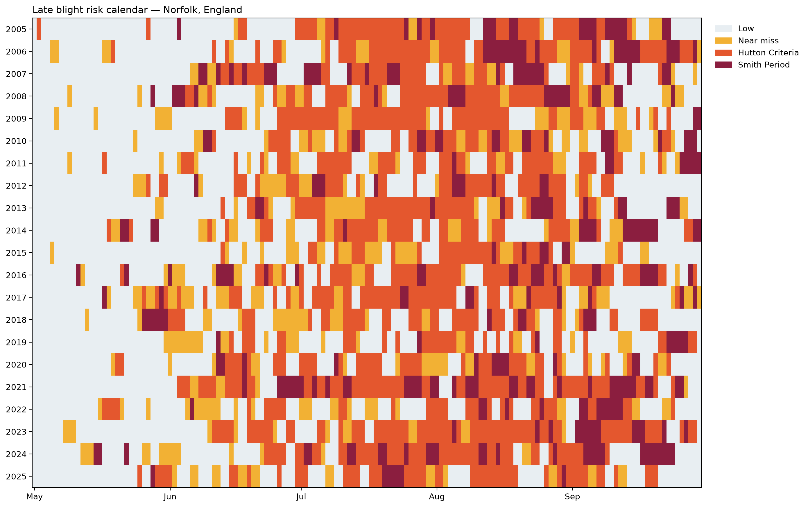
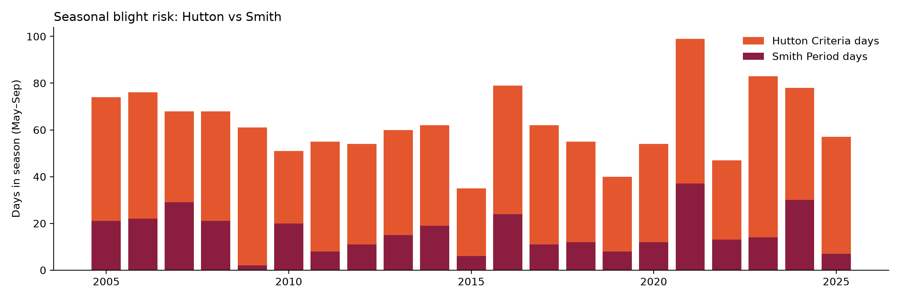

# Weather-Driven Late Blight Risk Model

Predicts when weather favours potato late blight (*Phytophthora infestans*) in Great Britain, using NASA POWER hourly weather data and the published **Smith Period** and **Hutton Criteria** rules.

**Author:** Muhammad Junaid Afzal

## What it does
- Downloads hourly temperature, humidity and rainfall for Norfolk, England (NASA POWER, 2005–2025)
- Converts hourly data into daily biological features (minimum temperature, hours with RH ≥ 90%, rainfall)
- Flags Smith Period, Hutton Criteria and near-miss risk days
- Produces a seasonal risk calendar and summary table
- Validates against reported high/low blight seasons
- Includes an ML pipeline (logistic regression, random forest, year-based split), ready for labelled outbreak data

## Key findings
- Hutton Criteria flagged 35–99 of 153 season days per year, likely because the gridded data (~50 km, coastal) shows frequent high humidity.
- Against six seasons with published blight reports (2007, 2012, 2018, 2021, 2022, 2023), Hutton counts agreed with 5/6, Smith 4/6 and season rainfall 6/6. Both rules missed 2012, a severe year, suggesting one ~50 km grid point misses regional risk.
- Outbreak-level and ML validation were not possible because no dated disease records were available.

## How to run
1. Install the libraries: `pip install -r requirements.txt`
2. Open `late_blight_risk_model.ipynb` and click **Run All**.

## Tools
Python, pandas, NumPy, matplotlib, scikit-learn, NASA POWER API

## Data acknowledgement
These data were obtained from the NASA Langley Research Center POWER Project funded through the NASA Earth Science Directorate Applied Science Program.

## References
- Dancey, S. R. (2018). *Development and implementation of a new national warning system for potato late blight in Great Britain.* PhD thesis, University of Dundee / James Hutton Institute.
- Smith, L. P. (1956). Potato blight forecasting by 90% humidity criteria. *Plant Pathology*, 5, 83–87.